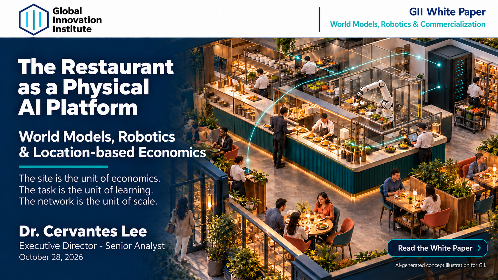

# The Restaurant as a Physical AI Platform

**World Models, Robotics AI & Restaurant Commercialization**

**Dr. Cervantes Lee**  
Global Innovation Institute (GII)  
October 28, 2026 · Version 1.0 — Location Network Edition · 162 pages

## Read the Report

**[Read or download the full research report (PDF)](./GII-Restaurant-Physical-AI-v1.0.pdf)**

Click the flyer above or the link to open the report.

## About This Research

This white paper examines restaurants as deployment environments for physical AI, world models, robotics, and intelligent kitchen systems. It connects technical capabilities with task economics, site readiness, employee and customer adoption, and the conditions for commercially viable deployment across locations.

The research considers how restaurant operations can inform robot learning and how technology providers and restaurant operators can evaluate the economics of implementation.

> The site is the unit of economics.  
> The task is the unit of learning.  
> The network is the unit of scale.

## Research Themes

- **Physical AI and robotics commercialization:** Connecting technical capabilities with operational needs and deployment feasibility.
- **World models and robot learning:** Examining restaurant tasks, operating environments, and learning data.
- **Restaurant unit economics:** Evaluating labor, throughput, equipment costs, utilization, and investment returns.
- **Site readiness and human adoption:** Assessing workflow integration, employee participation, and customer acceptance.
- **Intelligent kitchens and computing infrastructure:** Exploring connected equipment, cloud and edge computing, and operational coordination.
- **Technology supplier value capture:** Considering business models, competitive positioning, and the economics of scaling across locations.

## Intended Readers

This report is written for restaurant executives, robotics and world-model developers, technology suppliers, investors, educators, and researchers interested in the commercial deployment of physical AI.

## Publication Details

| Item | Details |
| --- | --- |
| Title | The Restaurant as a Physical AI Platform |
| Author | Dr. Cervantes Lee |
| Publisher | Global Innovation Institute (GII) |
| Publication date | October 28, 2026 |
| Version | 1.0 — Location Network Edition |
| Length | 162 pages |
| Format | PDF |
| Language | English |

## Suggested Citation

Lee, Cervantes. (2026). *The Restaurant as a Physical AI Platform*. Version 1.0, Location Network Edition. Global Innovation Institute. October 28.

## About Global Innovation Institute

Global Innovation Institute (GII) is a nonprofit AI-native research and education platform focused on AI infrastructure, physical AI, and physical commerce across the United States and East Asia.

GII connects company analysis with asset, site, and task-level economics to examine how capital and technology create sustainable value.

## Related Research

[Power-Constrained Silicon Valley: Data Center Real Estate Underwriting 101](https://www.giinow.org/research-notes/data-center-underwriting)

## Contact and Further Information

**Dr. Cervantes Lee**  
Global Innovation Institute (GII)

- Email: [clee@giinow.org](mailto:clee@giinow.org)
- Website: [www.giinow.org](https://www.giinow.org)
- Publication page: [The Restaurant as a Physical AI Platform](https://www.giinow.org/restaurant-physical-ai)

## Research Disclaimer

This publication provides independent educational research. It is not investment advice or a recommendation to transact.

Reported evidence, vendor claims, research hypotheses, and illustrative financial scenarios should be interpreted according to the qualifications and limitations stated in the report.

The flyer includes an AI-generated concept illustration for GII.
